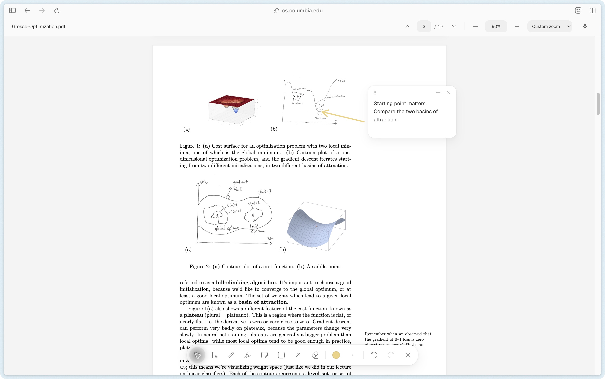

# Lasting Ink

Annotate webpages and PDFs. Your marks return when you reopen the page.

[Download extension](https://github.com/Sagar-CK/lasting-ink/releases/latest/download/lasting-ink-0.4.0.zip)



## Install

Requires Arc or Chrome with Chromium 151+.

1. Download and unzip the extension. Keep the folder somewhere permanent.
2. Open `chrome://extensions` and enable **Developer mode**.
3. Click **Load unpacked** and select the `lasting-ink` folder.
4. Open or refresh a webpage or PDF. The toolbar appears on the original URL.

## Use

| | Tool | Key |
| --- | --- | --- |
|  | Browse | V |
|  | Highlight selected text | H |
|  | Draw | P |
|  | Freehand highlight | M |
|  | Sticky note | N |
|  | Rectangle | R |
|  | Arrow | A |
|  | Erase | E |

PDF controls are at the top: page navigation, zoom percentage, fit to width/page, and download. The download button saves the original PDF. Scroll normally with any annotation tool selected.

Choose a color and stroke size from the round controls. Drag notes by their top edge. Press **Esc** to browse. Collapse the toolbar with **×**; reopen it with the pen button.

Annotations save automatically in this browser profile. No account or cloud sync. On webpages, the export button downloads all annotations as JSON; import is not available. Removing the extension clears its data.

Browser settings pages cannot be annotated. Password-protected PDFs use the native viewer. Major webpage layout changes can shift drawings. PDF search, print, and export with embedded annotations are not available yet.

## Development

The `extension/` folder is ready to load. To rebuild bundled assets and run tests:

```sh
npm ci
npm run build
npm test
npm run package
```

Node.js 22.22.2+, 24.15+, or 26+ and Python 3. The installable ZIP is written to `dist/`.

[Hugeicons](https://github.com/hugeicons/hugeicons-react) · [Geist](https://github.com/vercel/geist-font) · [PDF.js](https://github.com/mozilla/pdf.js). Bundled licenses are in [`extension/vendor/`](extension/vendor/).
