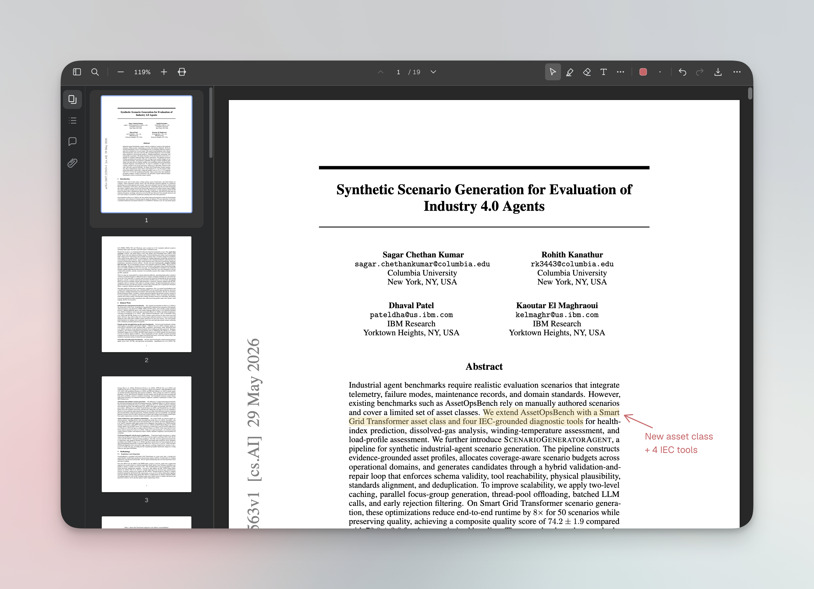
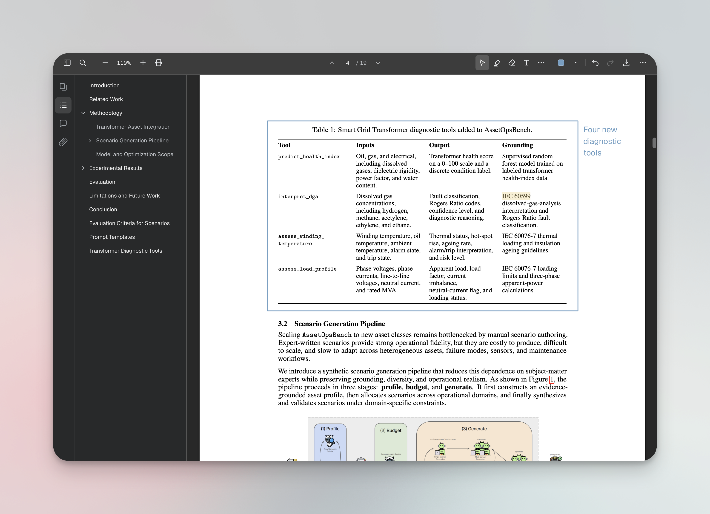

# Lasting Ink

A PDF reader for Chromium browsers. Highlight, draw and write on any PDF, and keep your notes with the file.

[Install](#install) · [Use](#use) · [Build from source](#build-from-source)

<p align="center">
  
  
</p>

- Opens PDFs in place of the browser's viewer. Links keep their URLs.
- One highlighter: drag across text to highlight it, or anywhere else to draw a highlighter stroke.
- Write text straight onto the page, draw, box and point with arrows. Every tool remembers its own colour and size.
- A sidebar with page thumbnails, a collapsible outline with your bookmarks, a searchable list of your notes, and embedded files.
- Find across every page, fill in forms, and recognize text in scanned PDFs on your device.
- Download with your annotations drawn into the PDF, or download the original.
- Reading position and zoom are remembered. Annotations follow the PDF across URLs and local copies.
- Everything stays in your browser profile. No account, server or analytics.

## Install

Requires a Chromium browser, version 151 or later, such as Chrome, Arc or Dia.

1. Build the extension (see [Build from source](#build-from-source)), or download a ZIP from [Releases](https://github.com/Sagar-CK/lasting-ink/releases) when one is published, and unzip it somewhere permanent.
2. Open `chrome://extensions` and turn on **Developer mode**.
3. Choose **Load unpacked** and select the `extension/` folder (or the unzipped `lasting-ink/` folder).
4. Open any PDF link. The toolbar button opens an empty reader for local files.

To update, replace the folder and press reload on the extension's card. Removing the extension deletes its storage, so export a backup first.

## Use

| Tool        | Key |
| ----------- | --- |
| Select      | V   |
| Highlighter | H   |
| Eraser      | E   |
| Text        | T   |
| Draw        | P   |
| Rectangle   | R   |
| Arrow       | A   |

Choosing the active tool again returns to Select. Draw, Rectangle and Arrow live under **⋯** in the toolbar.

- **Text:** click to place a box and type. Afterwards a click selects the box, dragging moves it, and a double-click (or Enter) edits it. Text sizes are 6, 8, 11 and 15 pt.
- **Drawings:** select one to move it or drag its corner to resize. Arrow keys move it, Alt+Arrow resizes, Shift takes larger steps. Delete removes the selection.
- **Undo:** `Cmd/Ctrl+Z`, redo with `Cmd/Ctrl+Shift+Z` (or `Ctrl+Y`).
- **Navigate:** Left/Right arrows turn pages. `Cmd/Ctrl+F` finds text on every page. `Cmd` + scroll or a pinch zooms; `Cmd/Ctrl +/−/0` zooms from the keyboard.
- **Save and print:** `Cmd/Ctrl+S` downloads with annotations and `Cmd/Ctrl+P` prints, with or without them.

**Document options** (the **⋯** at the far right) adds rotation, two-page view, presentation mode, text recognition, bookmarks, local files, backups and browser sync.

## Privacy and storage

Annotations, reading position, form values and recognized text are saved in your browser profile. PDFs are read from the page you opened; nothing is uploaded. Text recognition runs on your device with bundled English data.

Browser sync is off by default. Turned on in Document options, it syncs annotations, reading state and bookmarks through your browser account. PDF contents, recognized text and form values are never synced. Large libraries can exceed the browser's sync quota; use **Export annotation backup** to move everything.

The extension asks only for `storage`.

## Limitations

- Text recognition is English only. The recognized text works inside the reader; downloads don't include it.
- Password-protected PDFs open after you enter the password, which is not stored. If the encryption blocks editing, the annotated download is a flattened image copy without forms or selectable text.
- PDF scripts don't run. Text fields, checkboxes, radio buttons and lists work.
- Drawings become part of the page in downloads. Text that Helvetica can't render is kept as a PDF comment instead. Keep a backup to continue editing in Lasting Ink.

## Build from source

Requires Node.js 22.22.2+, 24.15+ or 26+, and Python 3 for packaging.

```sh
git clone https://github.com/Sagar-CK/lasting-ink.git
cd lasting-ink
npm ci
npm run build      # Icons, vendored PDF.js, OCR data and fonts into extension/
npm test
npm run package    # Installable ZIP in dist/
```

`npm run demo -- path/to/file.pdf` serves the reader at `http://localhost:8765` without installing the extension. Annotations are kept in memory. See [Screenshots](docs/SCREENSHOTS.md) for the README captures.

## License

[MIT](LICENSE). Built with [PDF.js](https://github.com/mozilla/pdf.js), [pdf-lib](https://github.com/Hopding/pdf-lib), [Tesseract.js](https://github.com/naptha/tesseract.js) and [Geist](https://github.com/vercel/geist-font); their licenses are bundled in `extension/vendor/`.
